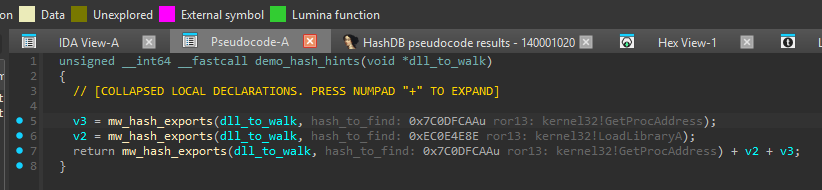

# Experimental pseudocode constant hints

This POC keeps the original numeric hash visible and adds a muted suffix after it:

```text
mw_hash_exports(dll_to_walk: v3, hash_to_find: 0x7C0DFCAA ror13: kernel32!GetProcAddress);
```

The suffix is a display annotation. It has no brackets or `/* */` delimiters and is not valid C source. Existing argument-name hints in this example are provided by IDA or another plugin; HashDB adds only the text after the constant.



The screenshot shows the locally tested renderer and results tab. The branch integrates that renderer into the existing Hunt workflow described below.

## Install this branch

1. Use IDA with Hex-Rays and Python 3.9 or later. The tested environment is IDA 9.4 / Hex-Rays 9.4 with Python 3.13.4 on Windows; this is not a compatibility claim for all IDA 7.5+ versions supported by the legacy plugin.
2. Install `requests` into the Python environment used by IDA.
3. Copy these four files from this branch together into your IDA plugin directory: `hashdb.py`, `hashdb_pseudocode.py`, `hashdb_inlay.py`, and `hashdb_algorithms.json`. Replace any previous HashDB installation rather than loading a second copy alongside it.
4. Restart IDA. Open a binary and a pseudocode function. The usual `Edit -> Plugins -> HashDB` entry still opens the original settings.

The scanner is optional: if Hex-Rays, the Python version, or a companion module is unavailable, the legacy lookup/IAT actions remain available and IDA logs the reason. The release workflow includes the companions, but this draft branch is not distributed by the upstream plugin manager or an existing release.

## Workflow

1. In the pseudocode window, highlight a numeric hash, then right-click and choose **HashDB Hunt Algorithm**.
2. Select an algorithm in the existing matched-algorithms chooser. Canceling or finding no algorithm stops here. Hunt still performs its normal algorithm-identification requests.
3. For a Hunt started in pseudocode, the new **Resolve pseudocode immediates** dialog opens after selection. It captures the function where Hunt started, even if focus moves while the request runs. A Hunt from disassembly keeps the original behavior.
4. Review the algorithm dropdown, API URL, optional XOR, optional DLL preference, request limit, and **Apply inline hints** checkbox. The dropdown initially follows the Hunt selection. **Refresh algorithms** explicitly fetches the latest catalog; opening the dialog uses a bundled snapshot and does not fetch metadata.
5. Click **Resolve** to query the entire originating function. This explicit click starts the function-wide lookups. Canceling the scan dialog does not start them; it also does not undo the algorithm chosen in Hunt.
6. Review the results chooser. It includes matches, missing results, and constants skipped because they do not fit the algorithm width. Repeated values share a request; every matching numeric occurrence receives a suffix when hints are enabled.
7. Use **HashDB: Show/hide pseudocode hints** in the pseudocode context menu under **HashDB**, or under **Edit -> Plugins**, to hide/show existing hints without new requests. **Clear hints in this function** removes the current function's annotations. **Cancel pseudocode scan** requests cancellation after the current HTTP request completes.

There is no separate resolve menu action. To scan again, invoke Hunt Algorithm on a constant, choose the algorithm, then use the scan options. Unchecking **Apply inline hints** gives a results-only scan and clears any previously applied hints for that function after successful completion.

## Verified example

HashDB calls this algorithm `ror13_add`. Its 32-bit state starts at zero; for each case-sensitive ASCII byte of the export name, rotate right by 13, add the byte, and mask to 32 bits. There is no terminating NUL and no DLL-name contribution.

| Export name | Hash | Display alias |
| --- | --- | --- |
| `GetProcAddress` | `0x7C0DFCAA` | `ror13` |
| `LoadLibraryA` | `0xEC0E4E8E` | `ror13` |

These values follow the [HashDB algorithm implementation](https://github.com/OALabs/hashdb/blob/main/algorithms/ror13_add.py). The module name comes from lookup metadata, not from the hash calculation. For a compact rendering matching the screenshot, enter `kernel32` as **Prefer DLL**. The default preference is empty and shows all returned modules. A preference only selects modules actually present in the response; it never invents a DLL. Hash collisions remain visible. Other algorithms retain their full identifier unless an explicit short-name alias exists.

The benign [C fixture](../examples/pseudocode_hashes.c) has calls using both hashes and a repeated `GetProcAddress` constant. Its dummy `mw_hash_exports` performs arithmetic; it does not resolve or invoke APIs. A Windows LLVM build from the repository root is:

```powershell
clang --target=x86_64-pc-windows-msvc -fuse-ld=lld -O0 -nostdlib examples/pseudocode_hashes.c '-Wl,/entry:demo_entry,/subsystem:console,/nodefaultlib' -o pseudocode_hashes.exe
```

Open the resulting binary in IDA and decompile `demo_hash_hints`. Hex-Rays may initially show decimal or signed constants; suffix placement works for those representations too. You can switch their numeric display to hexadecimal for comparison with the screenshot. Selecting `ror13_add`, preferring `kernel32`, and resolving should make two unique hash requests and annotate three occurrences. No fixture results are seeded into the plugin.

Verify the hashes independently:

```console
python examples/verify_hashes.py
python examples/verify_hashes.py --online
python -m unittest discover -s tests -v
```

The first command computes both hashes locally. The optional online command checks that HashDB currently returns the expected `kernel32` API metadata. The unit suite uses IDA stubs and makes no network requests.

## Implementation and behavior

- `hashdb.py` retains the existing plugin actions/settings and loads the optional scanner when Hex-Rays is available. Hunt passes a snapshot of its originating function to the scan options after algorithm selection and releases its request lock before a scan can begin.
- `hashdb_pseudocode.py` collects numeric ctree expressions, normalizes exact/zero-extended/sign-extended values without truncating arbitrary addresses, deduplicates requests, and uses the existing HashDB API client. Workers receive primitive snapshots and return data through a queue; IDA objects and view updates stay on the UI thread.
- `hashdb_inlay.py` decorates generated pseudocode through `func_printed` and `refresh_pseudocode` hooks. It uses ctree item anchors to insert a colored suffix after the full numeric token while preserving the existing anchors, color tags, and line count. This uses public IDAPython printing hooks; it is not a new native inlay-hint object or a modification of the decompiler's IR.
- Results/hints are scoped to a function in the current session. The new scan does not create enums, stored comments, rename symbols, change types, or patch bytes. Original lookup/bulk-import actions still have their existing enum behavior.
- Scans share the legacy HashDB request lock. Requests run sequentially, with a 15-second timeout and at least 0.65 seconds between them. The default cap is 500 unique values; exceeding it rejects the scan rather than silently processing a subset. The dialog permits a higher explicit cap up to 10,000.
- Cancellation, network failures, stale jobs after a database change, and completions from an old scanner instance do not apply partial/new hints. A previous successful set remains until another successful scan or a clear action. Unload removes registered actions/hooks and restores cached decorated text.

## POC limits and further testing

- The screenshot/local interactive test used IDA 9.4. Older IDA releases, other OSes, very large functions, and interactions with other text-decorating plugins need broader testing before merge.
- Hints are session-only and are not written to the IDB. Reopen/reload and resolve again to rebuild them. No persistent cache or cross-function propagation is implemented.
- Suffixes are inserted into generated text. Copying pseudocode includes them, and long collision lists can make lines wide. Inline labels are sanitized and capped at 240 characters; the chooser retains the full formatted result. Existing enum names and character/string literals are preserved rather than replaced by numeric hints.
- All numeric expressions in the ctree are candidates, including ordinary offsets and sizes. There is no heuristic that distinguishes an API hash from another immediate. Review matches as suggestions, especially with algorithms prone to collisions.
- Changing decompiler output or editing the function during a scan can make the captured numeric-value set outdated; rerun Hunt/Resolve to refresh it. Closing the database invalidates the scanner; reopen/reload the plugin to start again.
- The bundled catalog is a snapshot. Custom servers/new algorithms may require **Refresh algorithms**. Automatic rescans, persistent settings for the new controls, and plugin-manager packaging remain future work.
- The existing Hunt client can make its own metadata requests; the manual **Resolve** guarantee applies to the additional function-wide hash queries. Selecting Hunt's algorithm alone does not start those queries.

This change is intended for review and local experimentation as a draft, with compatibility and UI refinement still open.
